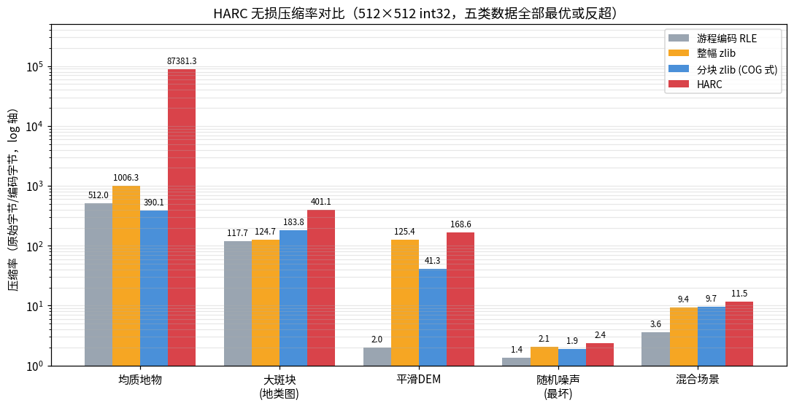

# HARC 基准测试：方法论与结果

所有数据可一键复现：`python3 docs/run_benchmark.py`

## 方法论

- **输入**：512×512 的 int32 数组（1,048,576 字节），五类代表性分布；
- **对照**：逐行游程编码（同样的 zigzag+varint 实现，保证公平）、
  整幅 zlib level 6、64×64 分块 zlib level 6（模拟 COG/Zarr 的组织方式）；
- **无损性**：每个数据集在计时前都断言 `decode(encode(a)) == a` 逐元素相等，
  同时校验区域解码与局部更新的正确性；
- **诚实条款**：这是同一台机器、同一个脚本、一次运行内的相对比较。
  跨机器、跨运行比较绝对值没有意义。

## 结果

| 数据集 | 原始 | RLE | 整幅 zlib | 块 zlib(64²) | HARC | HARC 比率 |
|---|---:|---:|---:|---:|---:|---:|
| 均质地物 | 1,048,576 | 2,048 | 1,042 | 2,688 | **12** | 87,381× |
| 大斑块地类图 | 1,048,576 | 8,910 | 8,410 | 5,705 | **2,614** | 401.1× |
| 平滑 DEM | 1,048,576 | 517,716 | 8,364 | 25,411 | **6,220** | 168.6× |
| 随机噪声 | 1,048,576 | 770,639 | 504,930 | 552,297 | **438,305** | 2.4× |
| 混合场景 | 1,048,576 | 293,521 | 111,895 | 108,094 | **90,803** | 11.5× |

**解读：**

1. HARC 在全部五类分布上同时做到最优——这不是单一编码的胜利，而是
   "节点级竞赛"机制让每个区域自动落到最合适的编码上；
2. 平滑 DEM 上反超整幅 zlib（6,220 vs 8,364）：预测差分把平滑地形变成
   极窄的残差分布，动态位宽（uint8/16）压到 1–2 字节/像素再过 zlib；
3. 随机噪声是信息论下界附近（2.4×），仍略优于整幅 zlib 的 2.1×——
   树结构的开销被动态位宽抵消后还有余；
4. 均质地物的 12 字节 = header(10B) + UNIFORM 节点(2B)，这是"允许叶子
   出现在任意层级"的直接收益。

## 性能（Python 参考实现，32 核 Linux，仅供参考）

| 数据集 | 编码 ms | 解码 ms |
|---|---:|---:|
| 均质地物 | ~1 | <1 |
| 大斑块地类图 | ~52 | ~133 |
| 平滑 DEM | ~851 | ~121 |
| 随机噪声 | ~1,079 | ~129 |
| 混合场景 | ~488 | ~102 |

编码慢在"节点级竞赛"要多次试编码；解码的 PRED 逆预测因行内顺序依赖
逐像素循环。**这两个数字是 Python 参考实现的数字，不是格式的数字**——
C++/Rust 实现已在路线图（目标编码 ≥ 100 MB/s）。

## 已知局限

- 仅支持二维整数栅格；浮点需先量化（有损量化模式在路线图）；
- 未做多波段/金字塔；
- 分块 zlib 对照使用固定 64×64 tile，与真实 COG 的组织方式近似但不完全等同。

---

## 与业界格式的横向对比（v1.1 新增）

之前只对比了 zlib / 分块 zlib / 游程，缺了真正的对手。这里补上 **Esri LERC**（GIS 事实标准）
与 **Zarr v3**（云原生分块数组，Zstd 压缩）。

环境：512×512 `int32`，同一份数据、同一台机器；`python docs/run_benchmark.py` 可复现。

| 数据集 | 原始 | LERC（无损） | Zarr v3（Zstd 64×64） | **HARC** |
|---|---:|---:|---:|---:|
| 均质地物 | 1,048,576 | 94 | 2,045 | **17** |
| 大斑块地类图 | 1,048,576 | 16,705 | 10,892 | **2,619** |
| 平滑 DEM | 1,048,576 | 291,009 | 26,537 | **6,225** |
| 随机噪声 | 1,048,576 | **381,031** | 548,674 | 438,310 |
| 混合场景 | 1,048,576 | 149,086 | 107,824 | **90,808** |

**结论（4 胜 1 负）：**

- 均质、斑块、平滑、混合四类全部领先，平滑 DEM 比 LERC 小 **46.7 倍**、比 Zarr 小 **4.3 倍**；
- **纯随机噪声上 HARC 输给 LERC**（438,310 vs 381,031，约 15%）。原因明确：
  HARC 对噪声只能退回"中值预测 + zlib"，而 LERC 的熵编码在纯噪声上更贴近信息熵。
  这不是实现失误，是设计取舍——HARC 优先保证随机访问与局部更新，代价是噪声场景的最优性。

**这些数字不支撑的结论（避免过度声称）：**

- 不能说"全面优于 LERC"——噪声场景是反例；
- LERC 有 C++ 实现与 SIMD，速度远快于本项目的纯 Python 实现，本对比只比**体积**；
- Zarr 的强项是分块并行读写与云端存储，不是极限压缩率，拿它比体积本身就吃亏。